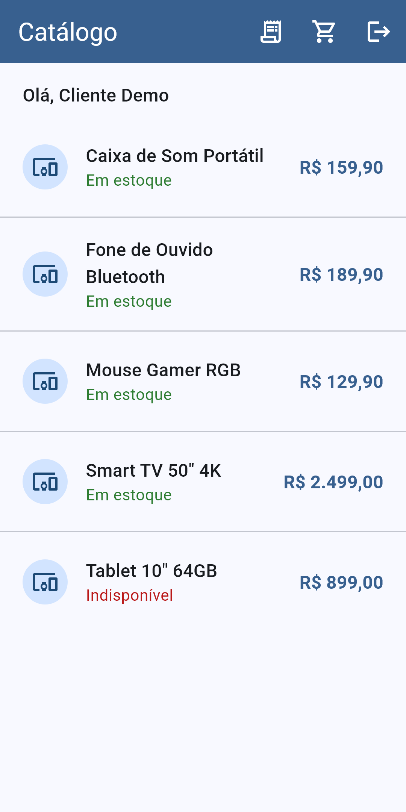
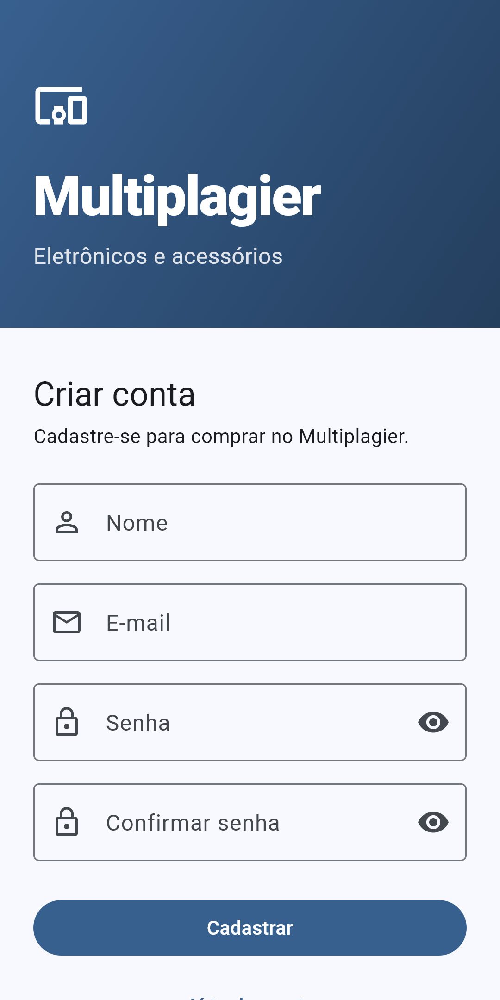
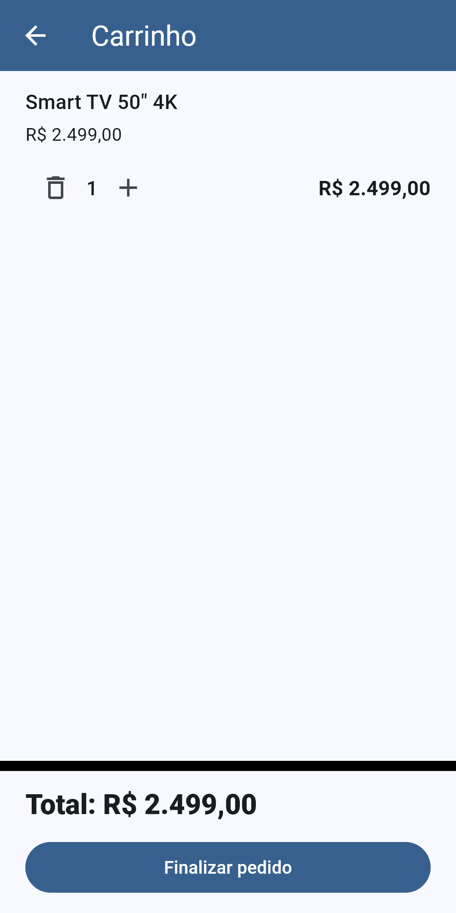
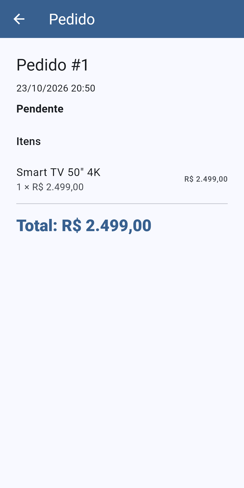

# Multiplagier Mobile

[](https://flutter.dev)
[](https://dart.dev)

App mobile acadêmico de e-commerce (eletrônicos e acessórios) da disciplina **ISG022 — Segurança no Desenvolvimento de Aplicações**, FATEC Mauá, 2026/2.

Referência de domínio (web Laravel): [vitor-dandrea/multiplagier](https://github.com/vitor-dandrea/multiplagier).

## Galeria

| Catálogo | Cadastro | Carrinho | Pedido |
|----------|----------|----------|--------|
|  |  |  |  |

## Status

| Funcionalidade | Status |
|----------------|--------|
| Configuração inicial (Flutter + SQLite + seed) | Concluído |
| Login local (login, logout, restauração de sessão) | Concluído |
| Catálogo (lista e detalhe de produtos ativos) | Concluído |
| Cadastro de cliente (US-001) | Concluído |
| Carrinho local | Concluído |
| Pedidos do cliente (US-006, US-007, SEC-001) | Concluído |
| Limite de tentativas de login (SEC-003) | Concluído |
| Busca e filtro do catálogo (US-009) | Concluído |
| Sincronização com API | Não iniciado |

Emulador Android validado em **05/11/2026** (AVD `Pixel_6_API_35`).

## Documentação

| Documento | Conteúdo |
|-----------|----------|
| [Arquitetura](docs/arquitetura.md) | Camadas, repositórios, SQLite e diagrama |
| [Padrões de projeto](docs/design-patterns.md) | Repository, Observer, Factory e tipos de resultado |
| [Instalação](docs/instalacao.md) | Ambiente Windows, emulador e primeiros passos |
| [Segurança](docs/seguranca.md) | PBKDF2, sessão, SEC-001, SEC-003 e regras de senha |
| [Fluxo Git](docs/git-fluxo.md) | Branches `main` / `dev` / `feat` e commits atômicos |
| [Guia de teste manual](docs/guia-teste-manual.md) | Emulador, USB e Wi‑Fi: comandos, credenciais e checklist offline |

## Usuário de demonstração

O banco SQLite é criado e populado na primeira execução.

| Campo | Valor |
|-------|-------|
| E-mail | `cliente@multiplagier.local` |
| Senha | `Multiplagier@2026` |

## Quick start

```bash
flutter pub get
flutter run
flutter test
```

## Ferramentas necessárias

| Ferramenta | Observação |
|------------|------------|
| **Flutter SDK** | Instalar em `C:\flutter` (**sem espaços** no caminho; o build nativo do `sqlite3` falha com espaços) |
| **Android Studio** | IDE e ferramentas do Android |
| **Android SDK** | Em `C:\Android\Sdk` |
| **AVD** | Emulador `Pixel_6_API_35` (validado em 05/11/2026) |
| **Modo de Desenvolvedor (Windows)** | Necessário para plugins Flutter no Windows (`start ms-settings:developers`) |
| **Node.js** | Apenas para gerar relatórios Word em `docs/` (`cd docs && npm install && npm run relatorio`) |
| **Git / gh** | Controle de versão e PRs no GitHub |
