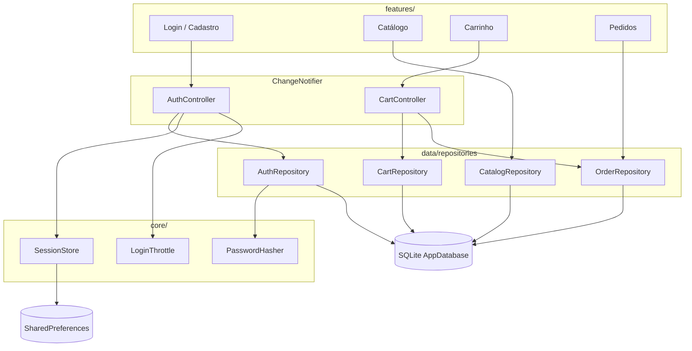

# Arquitetura

Visão geral da organização do código do **Multiplagier Mobile** (Flutter + SQLite local). A sincronização com API **não foi iniciada**; toda persistência é local.

## Camadas

```text
lib/
  main.dart            # bootstrap (factory SQLite por plataforma)
  app.dart             # MaterialApp e composição das telas
  core/                # tema, validação, formato, sessão e segurança
  data/
    db/                # AppDatabase, schema e seed
    models/            # entidades (User, Product, pedidos, carrinho)
    repositories/      # contratos e implementações SQLite
  features/            # UI + controllers por funcionalidade
    auth/
    catalog/
    cart/
    orders/
    home/
```

| Camada | Responsabilidade |
|--------|------------------|
| **features/** | Telas, navegação e `ChangeNotifier` (estado de UI) |
| **data/** | Modelos, schema SQLite, seed e repositórios |
| **core/** | Regras transversais: hash de senha, throttle de login, validação, formatação, sessão |

As features dependem de repositórios (interfaces), não do `Database` diretamente. Controllers orquestram casos de uso e notificam a UI.

## Repositórios

| Repositório | Papel |
|-------------|-------|
| `AuthRepository` | Cadastro, autenticação e busca por id |
| `CatalogRepository` | Produtos ativos (lista e detalhe) |
| `CartRepository` | Itens do carrinho por `userId` |
| `OrderRepository` | Checkout, listagem e detalhe isolados por usuário (SEC-001) |

Implementações atuais: `Sqlite*Repository`, usando `AppDatabase`.

## Estado (ChangeNotifier)

- `AuthController` — sessão, login, cadastro e logout.
- `CartController` — carrinho e finalização do pedido.

A UI escuta via `ListenableBuilder` / `AnimatedBuilder`. Não há sincronização remota: o estado reflete apenas o SQLite e a sessão em `SharedPreferences`.

## Persistência (SQLite)

- Arquivo: `multiplagier.db` (schema versionado em `AppDatabase`).
- Android: plugin nativo `sqflite`.
- Desktop / testes: `sqflite_common_ffi` (factory injetada no bootstrap).
- Tabelas principais: `users`, `products`, `cart_items`, `orders`, `order_items`, `security_events`.

## Diagrama



## Fluxo resumido

1. `main.dart` escolhe a factory SQLite, abre o banco, monta repositórios e restaura a sessão.
2. `AuthGate` decide entre login/cadastro e a home autenticada.
3. Catálogo, carrinho e pedidos leem/escrevem apenas dados do usuário logado.
